# Security Monitoring Lab

**Wazuh · Splunk Enterprise · Windows Server / Active Directory · Kali Linux**

**Author:** [Fifert2](https://github.com/Fifert2)  
**Milestone:** Authentication monitoring validated  
**Test date:** October 24, 2026, EDT; October 24–25, 2026, UTC

I configured and validated authentication-log collection across Linux and Windows in my Unraid homelab. I generated intentional failed logins, inspected Wazuh alerts, reviewed their built-in MITRE ATT&CK mappings, and collected Windows Security events in Splunk through a Universal Forwarder.

The most useful result was tracing the **same Windows failed-logon record through Wazuh and Splunk**, then confirming a second, newly generated event in Splunk. The project also exposed a distinction that matters during investigation: an ATT&CK label supplied by a detection rule needs to be checked against the underlying event.

This is a controlled home-lab validation. The activity was intentional and performed on systems I operate.

## Results at a glance

| Objective | Result | Supporting evidence |
| --- | --- | --- |
| Restore and verify Linux monitoring | Kali agent `001` active; intentional PAM failure triggered rule `5503`, level `5` | [Linux test](#1-linux-authentication-test) |
| Enroll Windows Server | DC01 agent `002` active and forwarding Windows events | [Windows enrollment](#2-windows-enrollment-and-authentication-test) |
| Detect a Windows failed logon in Wazuh | Event `4625`, record `7992`, triggered rule `60122`, level `5` | [Wazuh excerpts](evidence/wazuh-alert-excerpts.json) |
| Collect Windows Security events in Splunk | `index=main`, `host=DC01`, `source=WinEventLog:Security`; 3,718 events visible at the captured checkpoint | [Splunk collection](#3-splunk-collection-and-live-validation) |
| Verify historical and new event collection | Records `7992` and `8877` preserved in the second export | [Two-event export](evidence/splunk-failed-logons-two-events.json) |
| Apply ATT&CK critically | Reviewed `T1110.001`; identified that the Windows event did not substantiate the rule's `T1531` label | [ATT&CK analysis](#4-mitre-attck-analysis) |

The 3,718-event count is a search snapshot of general Security-channel activity, **not a count of attacks**. The two Splunk exports contain **two unique failed-logon events**: record `7992` appears in both exports.

## Contents

- [Environment and architecture](#environment-and-architecture)
- [1. Linux authentication test](#1-linux-authentication-test)
- [2. Windows enrollment and authentication test](#2-windows-enrollment-and-authentication-test)
- [3. Splunk collection and live validation](#3-splunk-collection-and-live-validation)
- [4. MITRE ATT&CK analysis](#4-mitre-attck-analysis)
- [5. Troubleshooting and operational decisions](#5-troubleshooting-and-operational-decisions)
- [6. Scope, limitations, and next work](#6-scope-limitations-and-next-work)
- [7. Evidence and reproducibility](#7-evidence-and-reproducibility)
- [References](#references)

## Environment and architecture

The lab runs on an Unraid host with an AMD Ryzen 9 5900X and 32 GB of installed RAM. Existing services share that memory. I worked in stages, shutting down unneeded VMs to keep the management interface responsive.

| Component | Role | Observed configuration |
| --- | --- | --- |
| Unraid / HM-Server | VM and Docker host | LAN `192.168.1.84`; private remote administration through Tailscale |
| `wazuh-server` | Wazuh manager, indexer, and dashboard environment | Ubuntu 24.04.4 LTS; LAN `192.168.1.80`; approximately 8 GB VM allocation |
| `kali-security-lab` | Linux endpoint and security workstation | Kali GNU/Linux 2026.3; LAN `192.168.1.72`; Wazuh agent `001`, v4.14.6; approximately 8 GB |
| `DC01` | Windows Server and Active Directory endpoint | Windows Server 2025 Standard Evaluation; `DC01.adlab.home.arpa`; domain `ADLAB`; LAN `192.168.1.70`; Wazuh agent `002`, v4.14.6; approximately 8 GB |
| Splunk Enterprise container | Search, indexing, and reporting | Official `splunk/splunk:latest` image; 6 GB configured memory limit; exact Enterprise build and active license state not captured |
| Splunk Universal Forwarder | Windows event collection on DC01 | Windows service `SplunkForwarder`; forwards to the Unraid host on TCP `9997` |

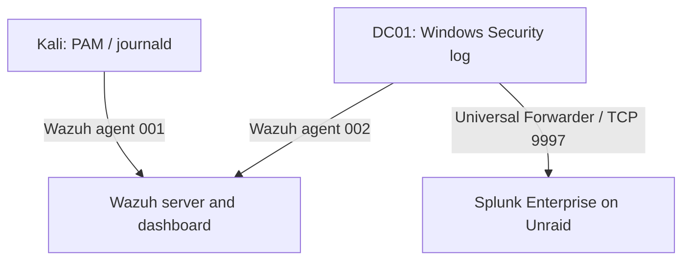

The diagram represents the configured collection paths. Wazuh and Splunk validation occurred in stages; it does not imply that all VMs ran concurrently. Splunk Enterprise runs in a container on Unraid. **The Universal Forwarder runs inside DC01.**

LAN addresses are used for communication among the lab systems. Tailscale provides the administrator's remote access path. The lab was not assessed for network segmentation or comprehensive hardening during this milestone.

## 1. Linux authentication test

### Objective and procedure

Verify the entire path from a local authentication failure to a searchable Wazuh alert.

1. Started Kali and confirmed its Wazuh agent was active.
2. Intentionally entered an incorrect password at the Kali graphical lock screen.
3. Located the PAM authentication failure in Wazuh.
4. Inspected the raw log, endpoint identity, rule ID, severity, timestamp, and ATT&CK metadata.

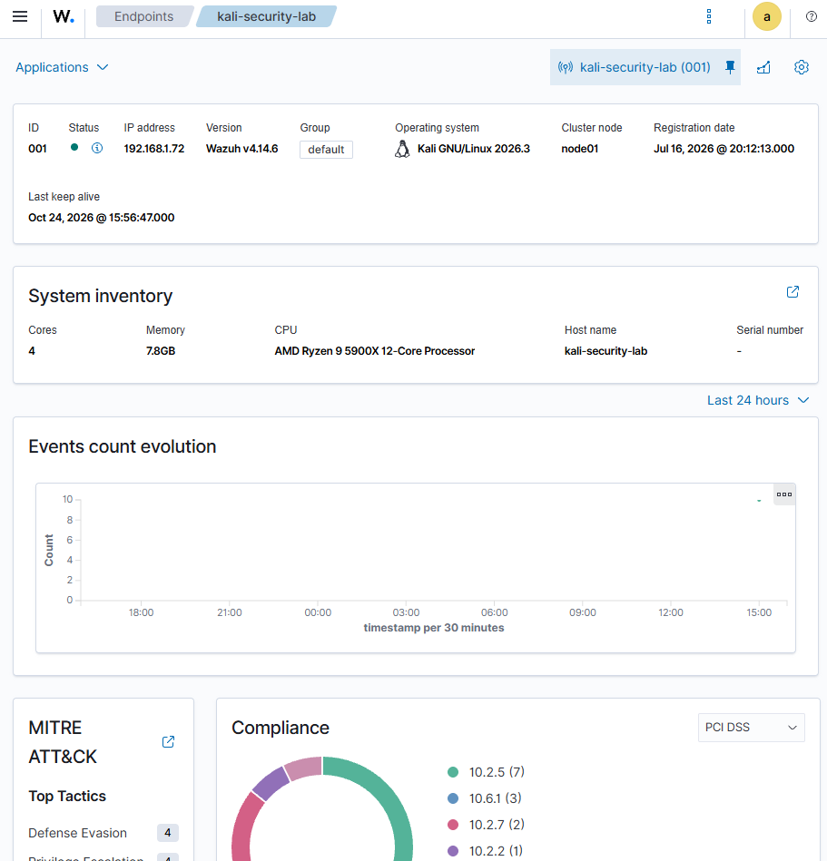

*E01. Endpoint inventory establishes which machine supplied the Linux telemetry.*

### Observed event

| Field | Value |
| --- | --- |
| Agent | `kali-security-lab`, ID `001` |
| Application | `xfce4-screensaver-dialog` |
| Collection location / decoder | `journald` / `pam` |
| User / terminal | `abdur` / `:0.0` |
| Wazuh event timestamp | `2026-10-24T20:39:36.017Z` |
| Rule | `5503` — PAM: User login failed. |
| Rule level | `5` |
| Built-in ATT&CK mapping | `T1110.001` — Password Guessing; Credential Access |

The raw event identifies a local screen-lock authentication failure:

```text
Oct 24 20:39:34 kali-security-lab xfce4-screensaver-dialog[56681]: pam_unix(xfce4-screensaver:auth): authentication failure; logname=abdur uid=1000 euid=1000 tty=:0.0 ruser= rhost=  user=abdur
```

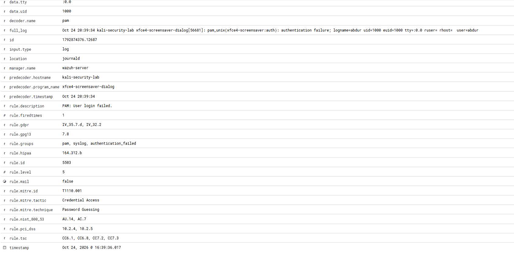

*E04. The event contains both the authentication-failure evidence and the rule's ATT&CK label.*

<details>
<summary>Additional Linux evidence: rule definition and endpoint fields</summary>

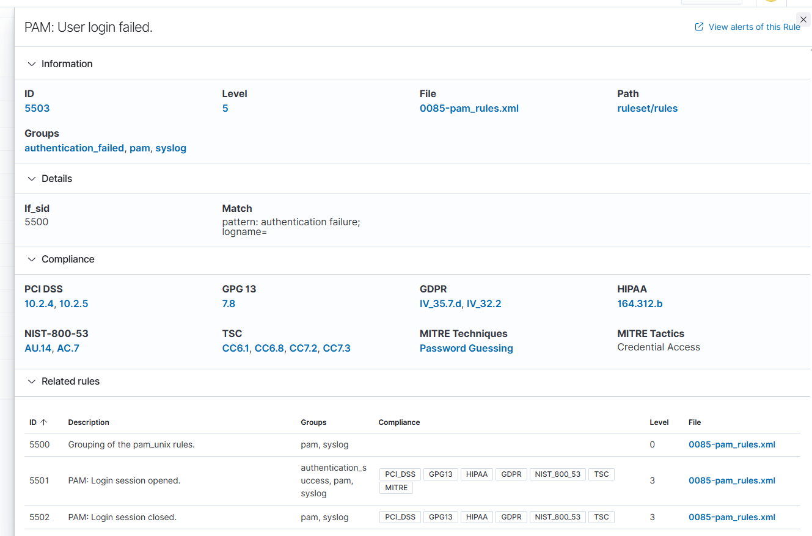

*E02. The built-in rule definition was inspected; no custom rule was authored in this exercise.*

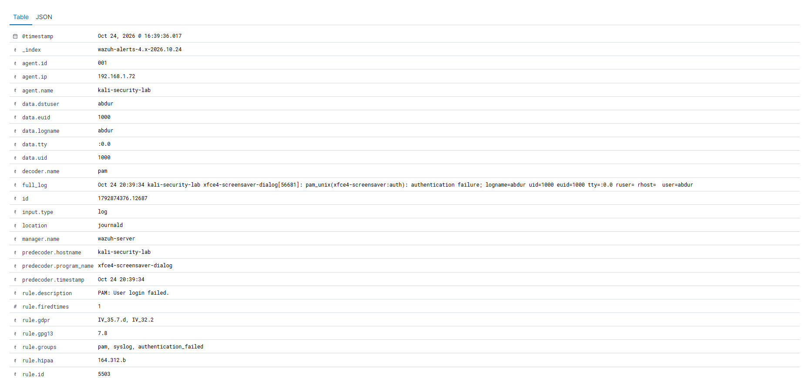

*E03. The upper event fields link the failure to agent 001 and the local graphical session.*

</details>

**Assessment:** Linux log collection and the failed-login rule worked for this test. A single deliberate bad password does not validate repeated-guessing thresholds, password spraying, or the detection of a complete brute-force campaign.

## 2. Windows enrollment and authentication test

### Enrollment and audit verification

I installed the Windows Wazuh agent and resolved an enrollment problem caused by a malformed manager-address setting. After correcting the configuration and enrolling the agent, DC01 appeared as active agent `002`.

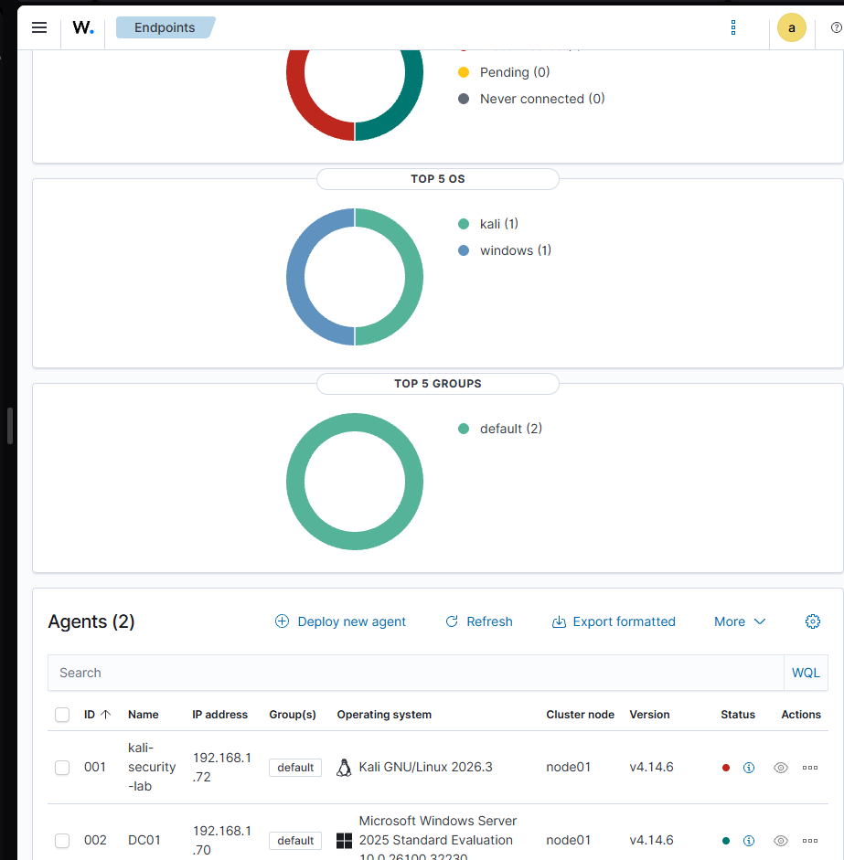

*E06. DC01 is active. Kali's disconnected state is expected because its VM was shut down to free RAM.*

The following checks established the test conditions:

```powershell
auditpol /get /subcategory:"Logon"
net accounts /domain
```

The captured audit policy enabled **Success and Failure** for Logon. The captured domain lockout threshold was **Never**; the displayed lockout duration did not mean lockout was enabled. These were observed lab settings, not a recommended production policy.

<details>
<summary>Windows audit policy and initial telemetry</summary>

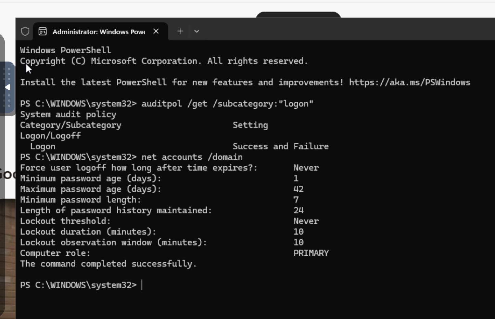

*E08. Audit-policy verification before the controlled failed-logon test.*

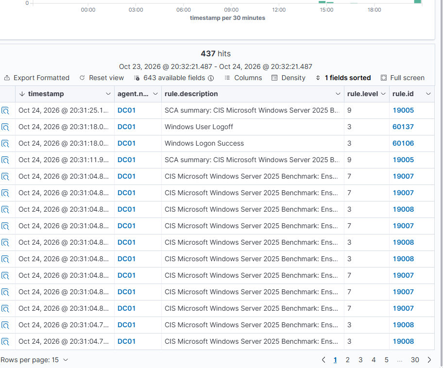

*E07. The snapshot shows 437 hits, including logon, logoff, and configuration-assessment events. It demonstrates telemetry arrival, not 437 incidents or verified compliance.*

</details>

### Controlled test

A dedicated domain account, `ADLAB\wazuh.lab`, was used. From PowerShell on DC01, I invoked:

```powershell
runas /user:$env:USERDOMAIN\wazuh.lab cmd
```

I intentionally supplied an incorrect password once. The attempt generated Windows Security event `4625` and Wazuh rule `60122`.

| Field | Observed value | Interpretation |
| --- | --- | --- |
| Computer / event record | `DC01.adlab.home.arpa` / `7992` | Identifies this record within the host's Security log |
| Event time, UTC | `2026-10-25T00:57:27.2926636Z` | Source Windows timestamp |
| Wazuh timestamp, UTC | `2026-10-25T00:57:29.150Z` | Wazuh alert timestamp; not an end-to-end performance benchmark |
| Event ID | `4625` | Failed logon |
| Target account | `ADLAB\wazuh.lab` | Account whose authentication failed |
| Subject account | `ADLAB\Administrator` | Context requesting the logon, not the failed target account |
| Logon type | `2` | Interactive logon |
| Source network address | `::1` | Localhost / IPv6 loopback |
| Status / substatus | `0xC000006D` / `0xC000006A` | Authentication failure with bad-password detail |
| Authentication package | `Negotiate` | Does not independently establish which underlying protocol was selected |
| Wazuh rule / level | `60122` / `5` | Logon Failure - Unknown user or bad password |

The field meanings are supported by [Microsoft's event 4625 reference](https://learn.microsoft.com/en-us/previous-versions/windows/it-pro/windows-10/security/threat-protection/auditing/event-4625). The source address and logon type fit the local `runas` test; this was not evidence of a remote RDP attack.

The Wazuh JSON supplied during the session is represented by explicitly labeled, selected-field [alert excerpts](evidence/wazuh-alert-excerpts.json). These excerpts preserve the original rule mapping while keeping the analyst's assessment separate.

## 3. Splunk collection and live validation

### Deployment and collection configuration

Splunk Enterprise was deployed as an Unraid Docker container. The working port and volume mappings were:

| Host setting | Container setting | Purpose |
| --- | --- | --- |
| TCP `10000` | TCP `8000` | Splunk Web |
| TCP `9997` | TCP `9997` | Forwarded event receiver |
| `/mnt/cache/appdata/splunk-official/etc` | `/opt/splunk/etc` | Persistent configuration |
| `/mnt/cache/appdata/splunk-official/var` | `/opt/splunk/var` | Persistent Splunk data |

The Windows Universal Forwarder used receiver `192.168.1.84:9997`. The Security-channel input was configured at:

```text
C:\Program Files\SplunkUniversalForwarder\etc\system\local\inputs.conf
```

```ini
[WinEventLog://Security]
disabled = 0
index = main
current_only = 0
renderXml = false
```

The corresponding [configuration snippet](config/inputs.conf) is included. It was reconstructed from the working session configuration, not exported from the host. The forwarder service was restarted after enabling the input.

### Validation sequence

First, the forwarder's internal events arrived:

```spl
index=_internal host=DC01
```

A screenshot captured **769 internal events**. That established forwarder communication, but did not establish that the Windows Security input was enabled. After configuring the input, the Security search returned events:

```spl
index=main host=DC01 source="WinEventLog:Security"
```

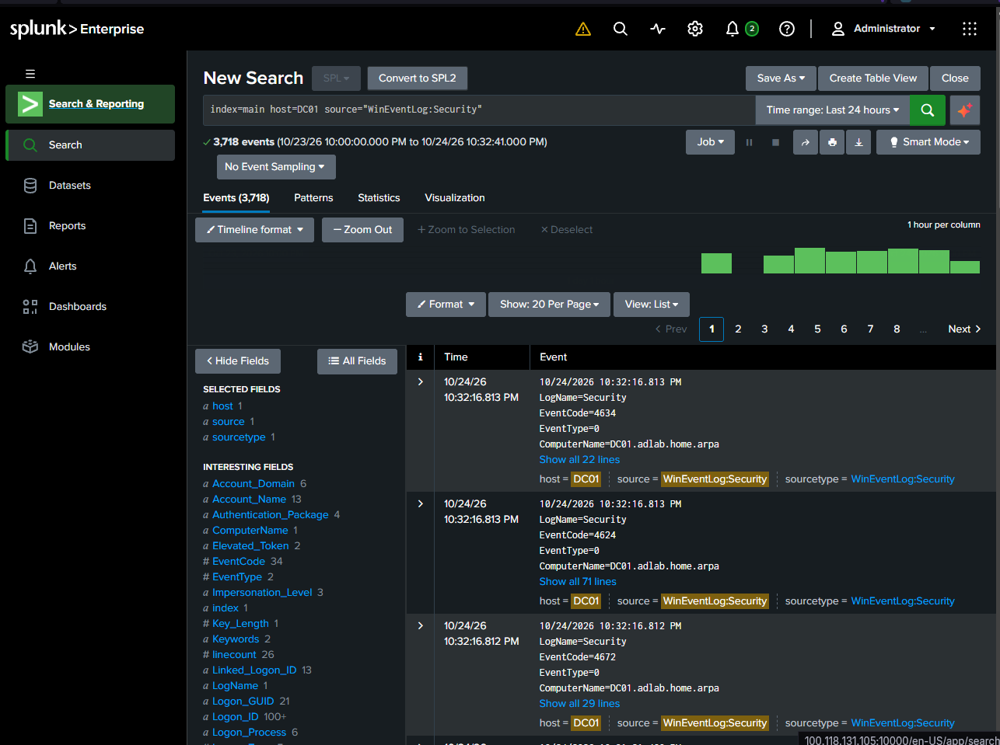

*E11. Security-channel collection is verified independently of the forwarder's internal logs.*

<details>
<summary>Forwarder connectivity checkpoint</summary>

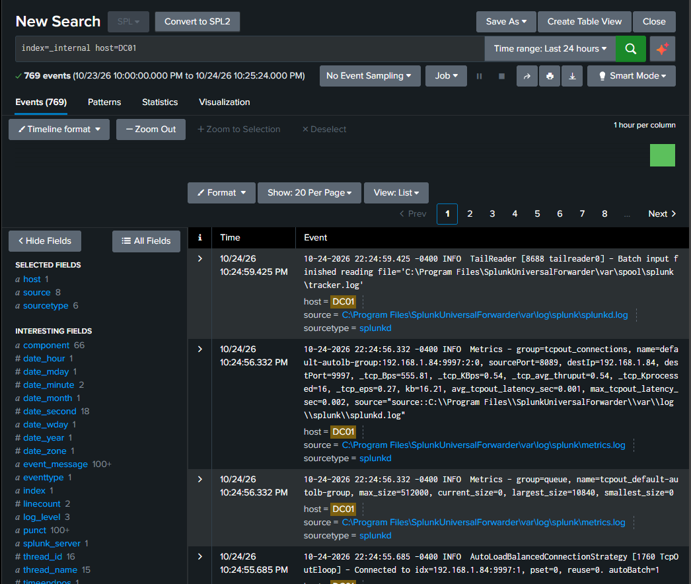

*E10. Internal telemetry arrived before the Security-channel input was working.*

</details>

I then narrowed the search to the test account's failed logons:

```spl
index=main host=DC01 source="WinEventLog:Security" EventCode=4625 "wazuh.lab"
```

This [saved search expression](queries/dc01-failed-logons.spl) initially returned record `7992`, the earlier event also present in Wazuh. The session produced a saved report and a one-event JSON export.

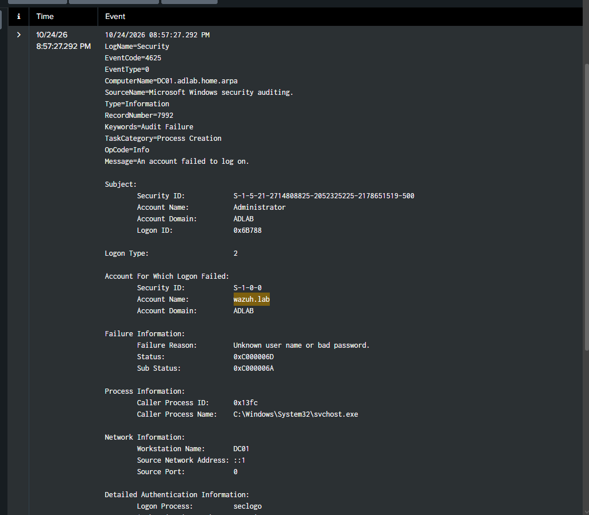

*E13. The raw event supports the failed-logon conclusion and identifies the target account.*

<details>
<summary>Search context for the first exported event</summary>

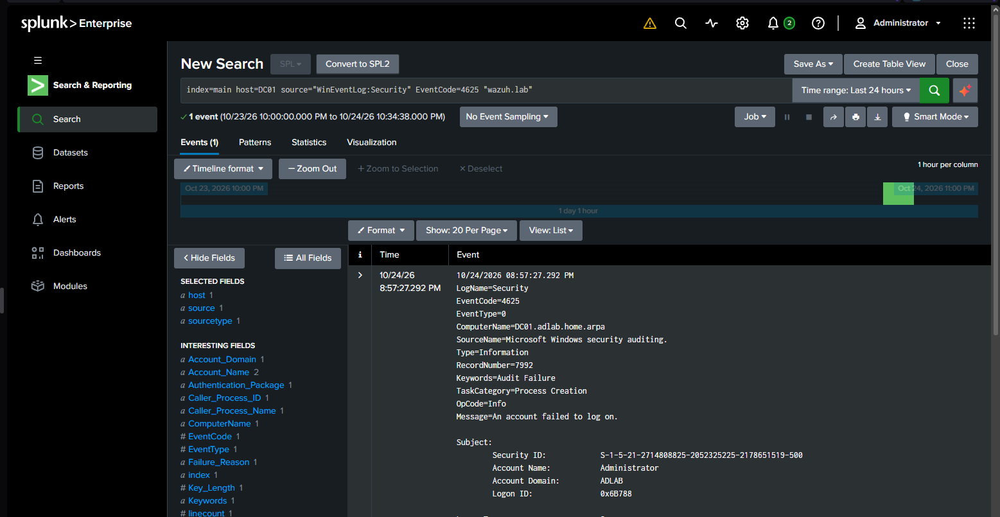

*E12. The search explicitly filters host, Security source, event code, and test-account text.*

</details>

Finally, I repeated the deliberate failed-password test after collection was configured. Splunk displayed the new event alongside the historical one, and I exported both.

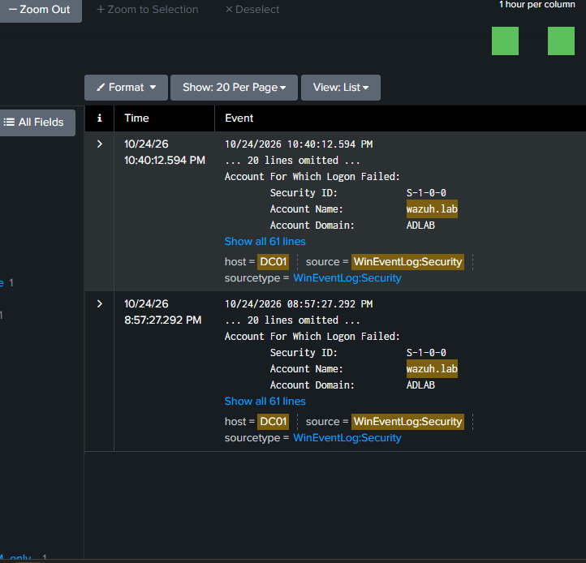

*E14. Two distinct source-event times verify the historical result and the fresh test. Exported record numbers are 7992 and 8877.*

### Cross-platform event comparison

| Evidence | UTC event time | EDT display / export time | Windows record |
| --- | --- | --- | --- |
| Wazuh Windows alert | Oct 25, `00:57:27.2926636` | Oct 24, approximately `20:57:27.292` | `7992` |
| Splunk historical event | Oct 25, `00:57:27.292` | Oct 24, `20:57:27.292-0400` | `7992` |
| Splunk fresh test | Oct 25, `02:40:12.594` | Oct 24, `22:40:12.594-0400` | `8877` |

The shared host, Security channel, event ID, record number, target account, and timestamp connect the Wazuh alert to the first Splunk event. This was **manual comparison**, not an automated integration between the two platforms. No Wazuh alert for record `8877` is included in the evidence.

Splunk's exported `Account_Name` field contains both `Administrator` and `wazuh.lab`. The raw event distinguishes the requesting subject from the failed target. Counting both values as attacked users would misstate the test. The export also contains `TaskCategory=Process Creation`; the event ID and raw failed-logon message support the authentication interpretation. That category discrepancy remains a parser/metadata review item.

**Assessment:** Historical Security-log collection and a newly generated failed-logon event were both validated. A saved search/report is not a scheduled detection alert; notification, thresholding, and automated response were not implemented here.

## 4. MITRE ATT&CK analysis

Wazuh provides rules with built-in ATT&CK IDs, and its dashboard groups matching alerts by tactics and techniques. I used those mappings during alert review; I did not create the built-in rules. [Wazuh documents both built-in mappings and custom-rule options](https://documentation.wazuh.com/current/user-manual/ruleset/mitre.html).

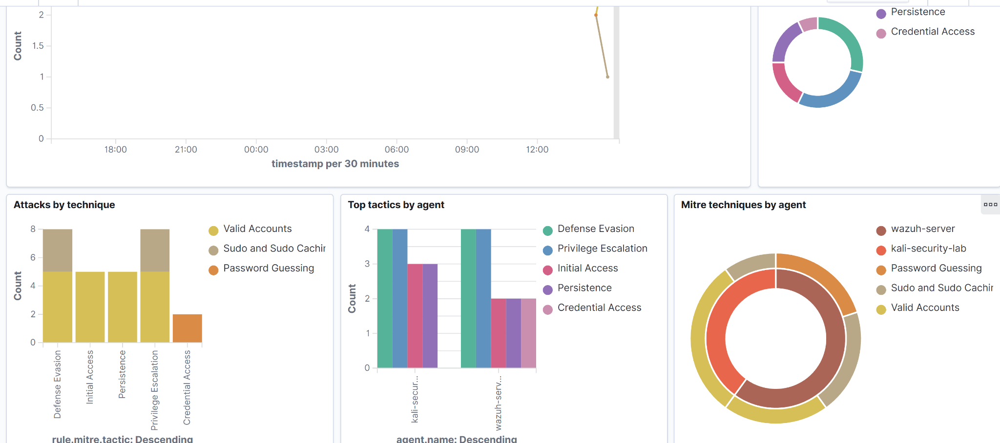

*E05. Dashboard categories provide investigation context. Their presence does not establish malicious activity or complete ATT&CK coverage.*

| Evidence | Rule-supplied mapping | Analyst assessment |
| --- | --- | --- |
| Kali intentional bad password; rule `5503` | `T1110.001` — Password Guessing / Credential Access | Relevant authentication telemetry for a password-guessing investigation. This single event validates collection and rule triggering, not a campaign or repeated-attempt threshold. |
| DC01 intentional bad password; rule `60122` | `T1531` — Account Access Removal / Impact | Unsupported as a description of the performed action. The event shows a bad password, with no evidence here of account deletion, disabling, or removal of access. |
| PAM session-open rule `5501` inspected | `T1078` — Valid Accounts | A successful session can be ordinary administration. A rule label alone does not demonstrate account compromise. |

[MITRE describes T1110.001](https://attack.mitre.org/techniques/T1110/001/) in terms of password guessing. [T1531](https://attack.mitre.org/techniques/T1531/) concerns disrupting legitimate account access. I retained the original Windows mapping in the evidence and documented why the observed test did not substantiate it. I did not change the Wazuh ruleset or claim that the Windows event proved either technique.

<details>
<summary>Baseline rule review: session-open mapping</summary>

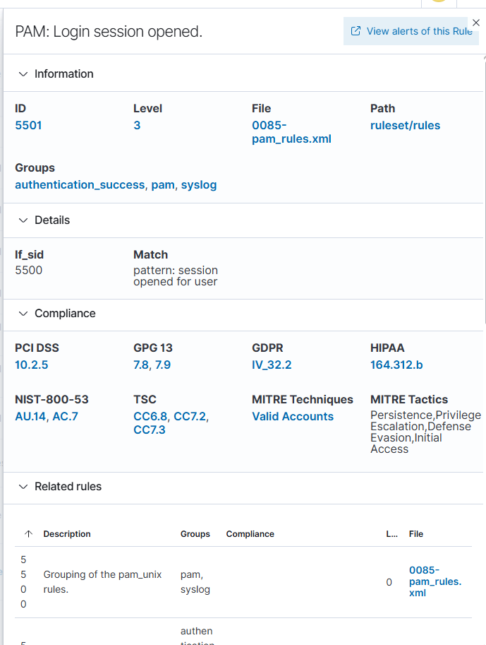

*E15. This supplied screenshot was inside a folder named `Wazuh_rule.5402`, but its visible rule ID is 5501. It is cataloged by the visible content.*

</details>

This work demonstrates **ATT&CK-informed alert analysis and mapping review**. It does not demonstrate complete ATT&CK coverage, custom detection engineering, or an automated attack emulation.

## 5. Troubleshooting and operational decisions

| Problem | Finding | Resolution and verification |
| --- | --- | --- |
| Kali appeared disconnected | Its VM was stopped | Started the VM; verified active agent `001` and a new alert. Later stopped it intentionally to reclaim memory. |
| Windows agent installed but absent from the dashboard | Installer arguments had been entered without the required separation, contaminating the manager setting; service status alone was insufficient | Corrected manager address, enrolled DC01, and verified active agent `002` plus Windows telemetry. |
| Splunk Docker startup problems | Template variables and a host-port conflict required correction | Used the official image configuration and host Web port `10000`; verified the application and subsequent ingestion. |
| Splunk rejected the original data location | `/mnt/user/...` resolved through Unraid's `fuse.shfs` user-share layer in this setup | Mapped persistent directories directly through `/mnt/cache/...`; startup and indexing subsequently worked. This is a deployment-specific finding, not a claim that every array filesystem is unsupported. |
| Internal logs arrived but Security search returned zero | Forwarder communication and event-input configuration are separate checks | Enabled the Security input, restarted the forwarder, and verified historical plus fresh events. |
| Host memory constrained simultaneous VMs | Multiple 8 GB guests competed with existing containers | Ran the lab in stages; used graceful shutdowns and a 6 GB Splunk container limit. |

<details>
<summary>Enrollment troubleshooting evidence</summary>

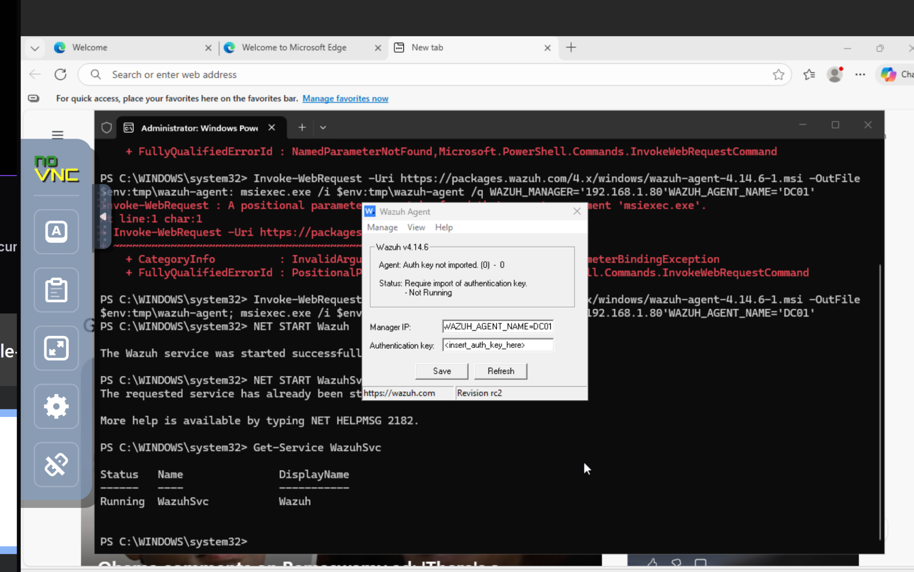

*E09. The pre-fix screenshot shows an invalid manager value and missing enrollment. E06 and E07 provide the post-fix verification.*

</details>

The direct cache mappings preserve data outside the container, but they are not a backup. Cache-share placement, Mover behavior, retention, and restore testing remain operational follow-ups. The host reported no swap-limit support, so the configured Docker memory/swap options should not be presented as proof of enforced swap control.

## 6. Scope, limitations, and next work

### Completed in this milestone

- Verified Linux and Windows Wazuh agents and centralized event collection.
- Generated and investigated a local Linux authentication failure and Windows failed-logon tests.
- Reviewed built-in ATT&CK mappings against event evidence.
- Deployed Splunk Enterprise on Unraid and configured a Windows Universal Forwarder input.
- Validated historical collection and a fresh event; preserved screenshots and JSON results.
- Documented enrollment, storage, port, and input-configuration troubleshooting.

### Related earlier work

Earlier project records describe Active Directory setup and domain-user authentication, Wireshark packet inspection, Kali/Metasploit practice, and OWASP ZAP against Juice Shop. This session confirmed the existing Windows Server environment and the availability of security tooling; it did not reproduce those earlier exercises in full.

Existing AD groups and permissions were reported as configured. A separate Windows-client permissions test was not repeated during this milestone. No new Metasploit exploit, packet-capture analysis, or ZAP finding is claimed by the evidence in this repository.

### Limits of the evidence

- All failed-logon activity documented here was intentional lab activity; no external attacker was identified.
- Linux and Windows tests were local. Network logon coverage, RDP/SSH attack behavior, and distributed sources were not validated.
- No measured detection rate, false-positive rate, sustained throughput, or end-to-end latency benchmark was produced.
- No custom Wazuh rule, scheduled Splunk alert, automatic response, or Splunk ATT&CK enrichment was implemented in this milestone.
- The exact running Splunk Enterprise version, license state, backup policy, and retention settings were not preserved.
- Screenshots and exports are learning evidence, not independently certified forensic records.

### Next milestones

- [ ] Record exact deployed versions and pin the Splunk image for reproducibility.
- [ ] Verify cache placement, retention, backup, and restoration of Splunk configuration and data.
- [ ] Create and test one scheduled authentication alert, including a benign baseline and notification evidence.
- [ ] Add a controlled repeated-failure scenario with documented account policy and expected thresholds.
- [ ] Capture allow/deny results for an AD group and file-permissions exercise using a suitable client or test session.
- [ ] Publish separate, evidence-backed Wireshark, ZAP/Juice Shop, and Metasploit case studies.

## 7. Evidence and reproducibility

### Included files

| Location | Contents |
| --- | --- |
| `README.md` | This report, procedures, observations, and interpretation |
| `assets/` | 15 selected screenshots, renamed for navigation; image contents unchanged |
| [One-event Splunk export](evidence/splunk-failed-logon-first.json) | Original supplied export containing record `7992` |
| [Two-event Splunk export](evidence/splunk-failed-logons-two-events.json) | Original supplied export containing records `8877` and `7992` |
| [Wazuh excerpts](evidence/wazuh-alert-excerpts.json) | Selected fields copied from the two Wazuh JSON alerts supplied in chat; explicitly labeled excerpts |
| [Evidence manifest](evidence/manifest.json) | Source filenames, evidence IDs, captions, and SHA-256 hashes for packaged screenshots and event evidence |
| [Security input](config/inputs.conf) | Working input settings transcribed from the session; no credentials |
| [Failed-logon search](queries/dc01-failed-logons.spl) | Search used to retrieve the Windows test events |

The Splunk files use newline-delimited JSON: each non-empty line is a JSON object with an event under `result`. Their `.json` filenames preserve the export convention. The first record was exported twice; combine exports by host, channel, and record number when checking unique events. For these preserved exports that yields two events, not three.

The manifest hashes support later file-integrity checks. They were generated while preparing this package; they do not independently authenticate the original capture time or constitute a formal chain of custody.

Screenshot selection favors endpoint state, rule details, raw event fields, search context, and before/after troubleshooting evidence. Duplicate views, unrelated account pages, and host screenshots exposing unrelated network details were omitted. Lab hostnames, test-account identifiers, private addresses, and event SIDs remain where they support the investigation. No passwords or enrollment keys are included.

### Repeating the validation

1. Start only the endpoint and monitoring platform needed for the current stage.
2. Confirm the agent/service is running and the intended log source is present.
3. Perform one controlled failed login on an authorized test account.
4. Search a time window covering the attempt; inspect the raw event and distinguish the target from the subject account.
5. Record UTC time, host, channel, event/rule ID, and record number where available.
6. Compare the event to the expected behavior and evaluate any rule-supplied ATT&CK mapping.
7. Save the query and export the event, then repeat with a new event to distinguish working live collection from historical data alone.

## Wazuh detection engineering — November 2026

[Read the rule-tuning lab](labs/wazuh-rule-tuning/README.md)

Implemented and validated custom Wazuh rules for repeated Windows incorrect-password failures. Five failures against the same account within 120 seconds escalate to a level-10 alert mapped to MITRE ATT&CK T1110.001. Positive and negative tests verified triggering, account separation, and expiration of older failures. Includes rule XML, screenshots, the positive alert export, and test results.

## References

- [Wazuh — MITRE ATT&CK framework and rule mappings](https://documentation.wazuh.com/current/user-manual/ruleset/mitre.html)
- [Microsoft — Windows Security event 4625](https://learn.microsoft.com/en-us/previous-versions/windows/it-pro/windows-10/security/threat-protection/auditing/event-4625)
- [MITRE ATT&CK — Password Guessing, T1110.001](https://attack.mitre.org/techniques/T1110/001/)
- [MITRE ATT&CK — Account Access Removal, T1531](https://attack.mitre.org/techniques/T1531/)
- [Splunk — Official Docker repository](https://github.com/splunk/docker-splunk)

External documentation supports the technical interpretation. The screenshots and supplied event exports support the results reported for this lab.
