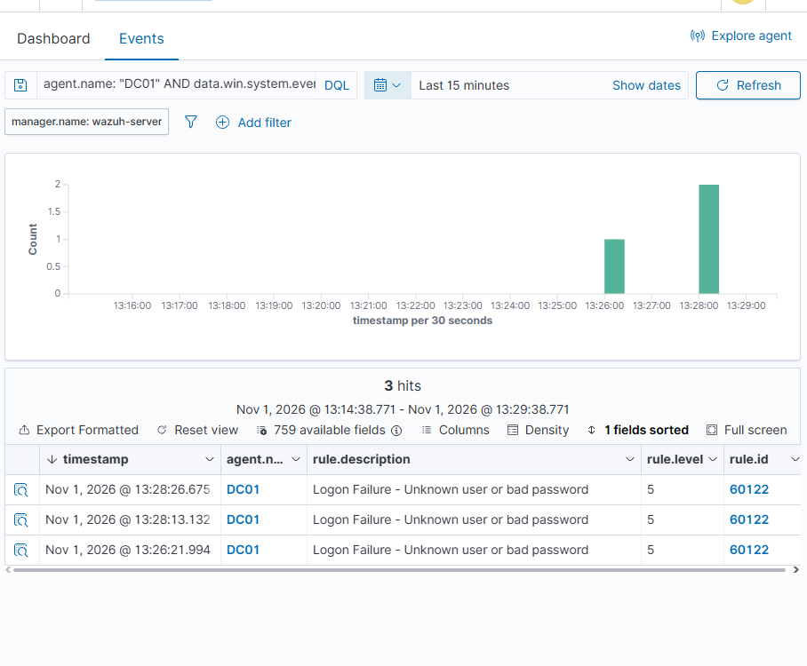
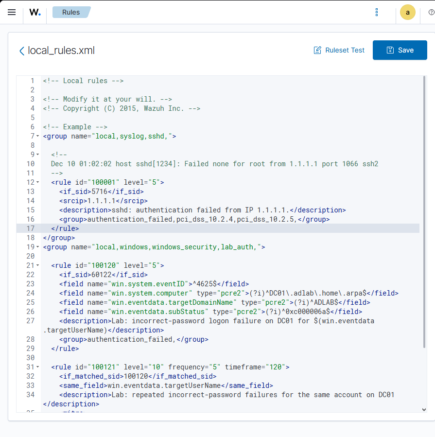
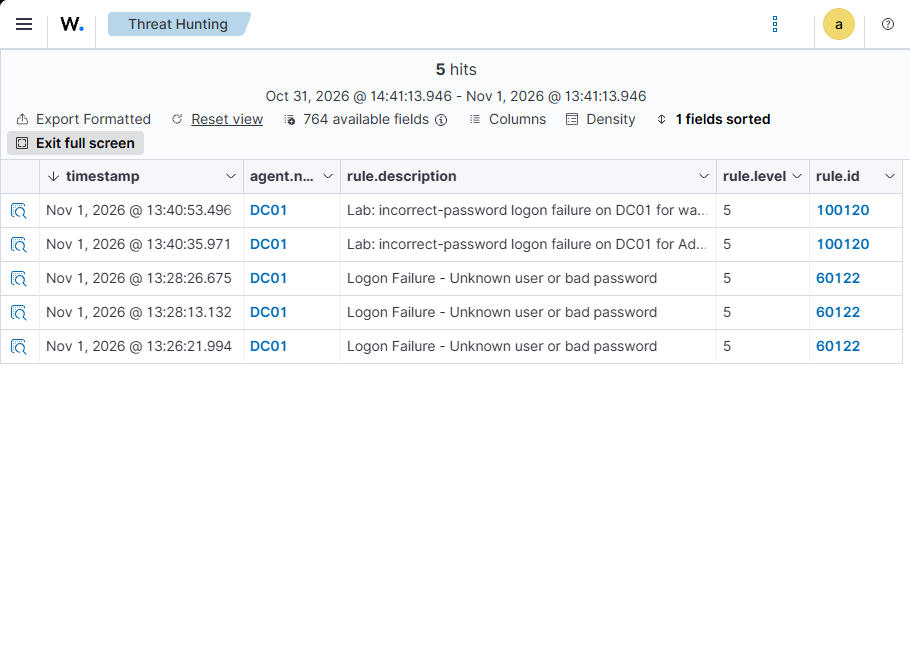
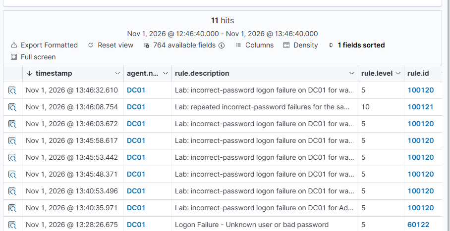
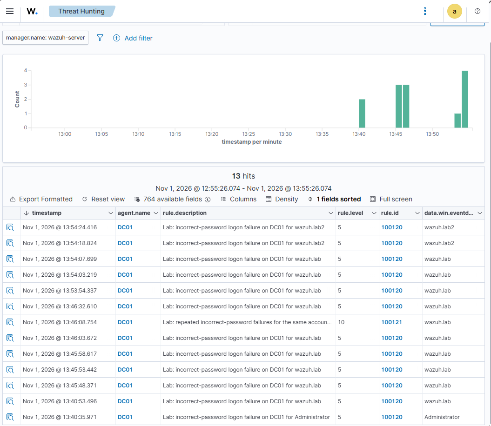
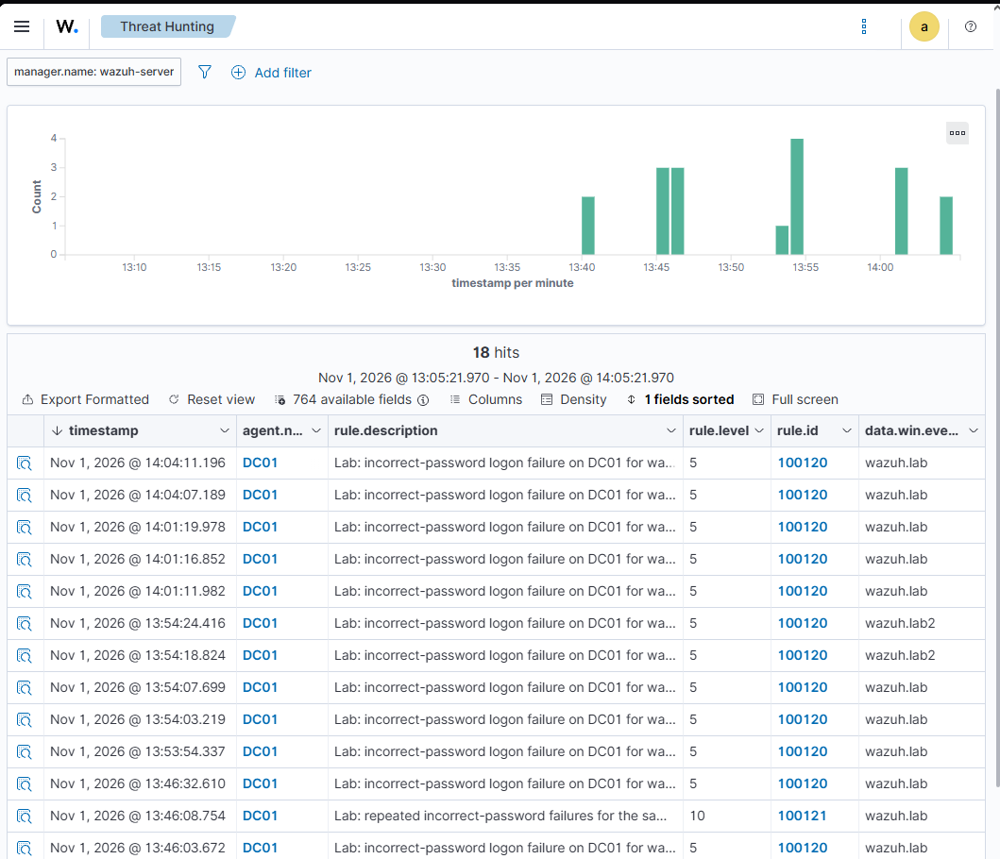

# Wazuh Rule Tuning: Account-Based Windows Authentication Correlation

**Author:** AbdurRahim Islam  
**Repository:** [Cyber-Security-labs](https://github.com/Fifert2/Cyber-Security-labs)  
**Completed:** November 1, 2026  
**Environment:** Self-owned Windows Active Directory and Wazuh homelab  
**Status:** Custom rules deployed; one positive and two negative tests passed

## Result

I implemented and validated a Wazuh correlation rule that escalates five incorrect-password failures against the same AD account on DC01 within 120 seconds. Individual failures remain visible at level 5; a qualifying sequence produces a level-10 alert mapped to **MITRE ATT&CK T1110.001 — Password Guessing**.

Three controlled tests verified the trigger, separation of accounts, and expiration of older failures. This demonstrates custom detection development and validation. It does **not** establish a measured reduction in false positives or production detection effectiveness.

## Objective and baseline

This lab extends my earlier authentication-monitoring work with Wazuh and Splunk. That exercise established collection and investigation; this exercise adds custom correlation logic and negative testing.

The installed `0580-win-security_rules.xml` contained these relevant defaults:

| Rule | Installed behavior |
|---|---|
| `60122` | Level-5 individual logon failure for Windows event 529 or 4625 |
| `60204` | Level-10 correlation of the `authentication_failed` group, grouped by `win.eventdata.ipAddress`; frequency 8 over 240 seconds |

The frequency variable `MS_FREQ` was 8 in the inspected file. In the controlled local `runas` tests, the source address was IPv6 loopback, `::1`. Grouping by that address alone does not distinguish failures against different accounts on DC01. The custom rule provides a complementary account-based view. The default rule was retained; this was not a head-to-head false-positive benchmark.


*Baseline: intentional failures reached DC01's Wazuh agent and matched default rule 60122.*

## Environment and data flow

| Component | Role |
|---|---|
| HM-Server / Unraid | Virtualization host |
| DC01 / Windows Server 2025 Evaluation | Active Directory domain controller; monitored endpoint |
| `DC01.adlab.home.arpa` / `ADLAB` | Computer FQDN and domain used to scope the rule |
| Wazuh agent `002` | Forwarded DC01 Security-channel events |
| `wazuh-server` | Applied individual-event and correlation rules |
| Wazuh dashboard | Rule editing, investigation, and evidence capture |
| `ADLAB\wazuh.lab`, `ADLAB\wazuh.lab2` | Dedicated test accounts |

Windows authentication attempt → Security event 4625 → Wazuh agent → Wazuh manager → custom rule evaluation → dashboard alert.

Splunk was not used to validate this custom detection. Existing project notes record Wazuh agent 4.14.6; a fresh version inventory of all Wazuh components was not captured in this session.

## Detection design

| Rule | Purpose | Conditions / output |
|---|---|---|
| `100120` | Select eligible failures | Inherits from 60122; event 4625; computer DC01; domain ADLAB; incorrect-password substatus `0xc000006a`; level 5 |
| `100121` | Correlate by target account | Five matches of 100120 within 120 seconds with the same `win.eventdata.targetUserName`; level 10 |

The computer, domain, and substatus patterns are case-insensitive. Username grouping uses the decoded value without an explicit normalization step. The rule does not restrict logon type or source address, although the observed tests were local interactive attempts (type 2, source `::1`).

### Custom XML

Append this group after the existing group in `/var/ossec/etc/rules/local_rules.xml`, after checking that both IDs are unused. The SSH sample already in that file was preserved.

```xml
<group name="local,windows,windows_security,lab_auth,">

  <rule id="100120" level="5">
    <if_sid>60122</if_sid>
    <field name="win.system.eventID">^4625$</field>
    <field name="win.system.computer" type="pcre2">(?i)^DC01\.adlab\.home\.arpa$</field>
    <field name="win.eventdata.targetDomainName" type="pcre2">(?i)^ADLAB$</field>
    <field name="win.eventdata.subStatus" type="pcre2">(?i)^0xc000006a$</field>
    <description>Lab: incorrect-password logon failure on DC01 for $(win.eventdata.targetUserName)</description>
    <group>authentication_failed,</group>
  </rule>

  <rule id="100121" level="10" frequency="5" timeframe="120">
    <if_matched_sid>100120</if_matched_sid>
    <same_field>win.eventdata.targetUserName</same_field>
    <description>Lab: repeated incorrect-password failures for the same account on DC01</description>
    <mitre>
      <id>T1110.001</id>
    </mitre>
    <group>authentication_failures,</group>
  </rule>

</group>
```

Files included:

- [Custom Windows group only](rules/windows_auth_correlation.xml) — suitable for review or merging into an existing local rules file.
- [Session configuration](rules/local_rules.xml) — reconstructed from the supplied SSH example and the custom group used in this session; not a fresh server-side export.

Do not blindly replace an existing manager's local rules file with the session configuration. Preserve other local rules and check IDs before deployment.


*The custom group was appended after the preserved SSH example. This editor screenshot shows the draft before saving; later live alerts establish that the rules were activated.*

## Implementation and validation

I inspected the default rule and correlation behavior, reviewed `local_rules.xml`, added the two custom rules, saved the configuration, and restarted the manager before validating live events.

The original plan used Ruleset Test. Wazuh's EventChannel processing differs from ordinary JSON log testing, so the session used actual Windows events for validation rather than treating a generic logtest result as proof of the live pipeline. See the [Wazuh maintainer explanation](https://github.com/wazuh/wazuh/issues/30472).

The baseline command was:

```powershell
runas /user:ADLAB\wazuh.lab cmd
```

Entering an intentionally incorrect password generated the failure. The account-name and failure-code fields, rather than the initiating Administrator account, identified the attempted target.


*New events matched 100120 at level 5 after deployment; older events retained their original 60122 classification.*

### Test 1: same account within the window

Five failures against `ADLAB\wazuh.lab` produced correlation alert 100121. The original JSON contains four prior events in `previous_output` plus the triggering fifth event.

| Windows record ID | Windows `systemTime` (UTC, abbreviated) | Target | Substatus |
|---|---|---|---|
| 15458 | 17:45:46.9328522 | wazuh.lab | 0xc000006a |
| 15460 | 17:45:52.0022489 | wazuh.lab | 0xc000006a |
| 15462 | 17:45:57.1786912 | wazuh.lab | 0xc000006a |
| 15464 | 17:46:02.2297000 | wazuh.lab | 0xc000006a |
| 15466 | 17:46:07.3106968 | wazuh.lab | 0xc000006a |

The five source-event timestamps span approximately **20.4 seconds**. The resulting alert specifies `frequency: 5`, `level: 10`, and technique T1110.001.


*The fifth matching failure generated the level-10 correlation alert at dashboard time 13:46:08.754.*

### Test 2: different accounts

After a quiet interval, I generated three failures against `wazuh.lab` and two against `wazuh.lab2` within approximately 30 seconds. Each event matched 100120. No new 100121 alert appeared for that sequence because neither account reached five failures.


*The five newest rows show the 3+2 account split. The earlier 13:46 correlation alert remains visible and belongs to Test 1.*

### Test 3: failures outside the window

Three failures against `wazuh.lab` appeared at dashboard times 14:01:11.982, 14:01:16.852, and 14:01:19.978. Two more appeared at 14:04:07.189 and 14:04:11.196. The gap between batches was approximately **167 seconds**, exceeding the 120-second window. All five remained individual 100120 alerts; no new 100121 alert appeared for this sequence.


*Two separated batches did not combine into a five-event correlation alert.*

### Test summary

| Test | Expected | Observed | Result |
|---|---|---|---|
| Same account, five failures within 120 seconds | 100121 at level 10 | Correlation alert and five underlying records verified | PASS |
| Two accounts, split 3+2 | Individual alerts only | Five 100120 events; no new 100121 shown | PASS |
| Same account, split 3+2 with gap over 120 seconds | Individual alerts only | Five 100120 events; no new 100121 shown | PASS |

[Machine-readable results](tests/results.csv). Negative-test findings are supported by the supplied dashboard captures; separate raw exports for those sequences were not supplied.

## Investigation queries

```text
agent.name: "DC01" AND (rule.id: "100120" OR rule.id: "100121")
```

```text
agent.name: "DC01" AND rule.id: "100121"
```

Useful columns: `timestamp`, `agent.name`, `rule.description`, `rule.level`, `rule.id`, and `data.win.eventdata.targetUserName`. Set a time range that includes the test and distinguish previous positive alerts from the current negative sequence.

[Additional DQL searches](queries/threat-hunting.dql).

## ATT&CK interpretation and limitations

The custom correlation alert carries **T1110.001 / Credential Access**. Repeated controlled bad-password attempts simulate behavior relevant to password guessing; the label does not establish that a real adversary was present.

The earlier default alert attached T1531 (Account Access Removal), which the observed incorrect-password test did not support. The custom correlation alert explicitly produced T1110.001. This does not change the packaged default rules or retroactively relabel historical alerts.

Scope and unresolved items:

- This detection is intentionally limited to DC01, ADLAB, event 4625, and bad-password substatus 0xc000006a. Other failure causes and endpoints are outside its filter.
- Fewer than five failures, slow attempts, or activity distributed across accounts can avoid this correlation rule. Separate password-spraying and other authentication detections are needed for broader coverage.
- The five-event threshold is a lab hypothesis, not a production recommendation.
- Individual failures remain at level 5. No alert suppression or measured false-positive reduction was demonstrated.
- Effective AD lockout policy was not successfully captured. Future repetitions should inspect it and use dedicated test accounts.
- Windows `systemTime` and manager alert timestamps differ by approximately one hour. For example, the triggering source event is 17:46:07 UTC while the manager alert is 18:46:08 UTC. The offset is unresolved; do not interpret it as ingestion latency. The dashboard shows the latter at 13:46 EST. Within-source sequence timing still supports the positive test.
- The negative tests validate the observed sequences, not every boundary case. Exact 120-second boundary behavior, username case variation, restart behavior, and production load were not tested.

## Evidence and reproducibility

- [Original positive alert JSON](evidence/events/positive-alert-original.json) — unchanged supplied export.
- [Derived positive-event summary](evidence/events/positive-alert-summary.json) — explicitly labeled extraction from that export.
- [SHA-256 inventory](evidence/SHA256SUMS.txt) — hashes for screenshots, event files, rules, searches, and test results included in this package. These establish package-byte consistency, not authenticity of the source system.

To reproduce, confirm collection first, inspect the installed rules and unused IDs, merge the custom group, activate it, and run the three controlled sequences with quiet intervals between tests. Retain the effective lockout policy and clock checks in any future reproduction.

## Skills demonstrated

Windows Security event investigation; Wazuh rule inheritance and XML configuration; event correlation; account-based grouping; threshold and time-window selection; positive and negative validation; MITRE ATT&CK interpretation; and evidence-based technical reporting.

## References

- [Wazuh custom rules](https://documentation.wazuh.com/current/user-manual/ruleset/rules/custom.html)
- [Wazuh rule syntax](https://documentation.wazuh.com/current/user-manual/ruleset/ruleset-xml-syntax/rules.html)
- [Windows event 4625](https://learn.microsoft.com/en-us/windows/security/threat-protection/auditing/event-4625)
- [MITRE ATT&CK T1110.001](https://attack.mitre.org/techniques/T1110/001/)
- [Wazuh EventChannel testing limitation](https://github.com/wazuh/wazuh/issues/30472)
